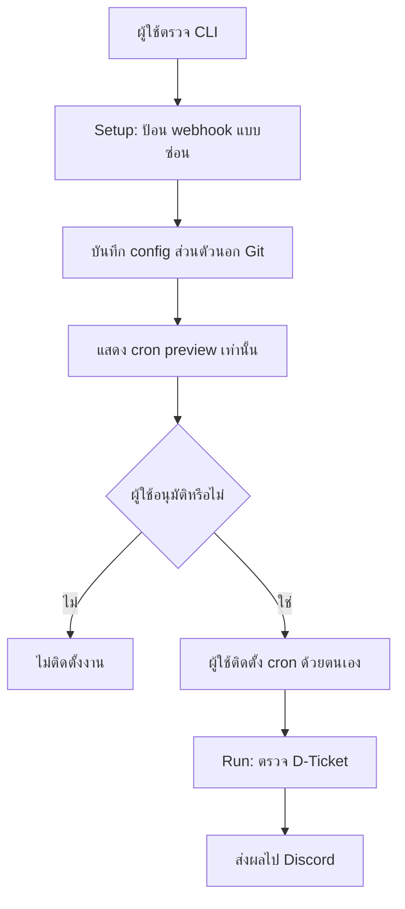

# D-Ticket monitor

[EN](README.md) | **TH**

เครื่องมือค้นหาเที่ยวรถและตรวจจำนวนที่ว่างในหมวดรถนอนสำหรับผู้โดยสารทั่วไป จากเว็บไซต์ D-Ticket ของการรถไฟแห่งประเทศไทย ใช้ผ่านบรรทัดคำสั่งบนเครื่องของคุณ หรือให้ AI agent ช่วยเรียกใช้งาน

## ทำอะไรได้บ้าง

- ค้นหาสถานีด้วยชื่อภาษาไทยหรือภาษาอังกฤษ
- ตรวจเที่ยวรถนอนตามสถานีต้นทาง ปลายทาง วันที่ และหมายเลขขบวนที่ต้องการ
- แสดงจำนวนที่ว่างระดับหมวดโดยสารและราคาเตียงที่เว็บไซต์ส่งกลับมา
- ให้ AI agent ช่วยเรียกโปรแกรม หรือเลือกตั้งเวลาเรียกสคริปต์โดยไม่ใช้ AI ในแต่ละรอบ

การค้นหาเป็นแบบอ่านข้อมูล **ไม่เข้าสู่ระบบ ไม่จองตั๋ว ไม่เลือกที่นั่ง และไม่ชำระเงิน** สคริปต์เสริมส่งผลไป Discord ได้เมื่อผู้ใช้ตั้งค่าและเรียกใช้งาน แต่ไม่ติดตั้ง cron เองและไม่มีระบบแจ้งเฉพาะเมื่อผลเปลี่ยน

> จำนวนที่แสดงเป็นจำนวนระดับหมวดโดยสาร ไม่ยืนยันว่าเตียงบนหรือเตียงล่างว่าง และไม่รับประกันว่าจะจองได้ ตรวจสอบกับ [D-Ticket](https://dticket.railway.co.th/DTicketPublicWeb/) อีกครั้งก่อนเดินทาง

## สิ่งที่ต้องมี

- Python 3.9 ขึ้นไป และ Git
- อินเทอร์เน็ตสำหรับติดตั้ง dependencies และค้นหาข้อมูล
- เทอร์มินัลสำหรับรันคำสั่ง ไม่จำเป็นต้องติดตั้ง AI agent
- AI agent เป็นทางเลือก หากต้องการสั่งงานผ่านภาษาธรรมชาติ; ตัวอย่างการติดตั้ง Skill และการตั้งเวลาด้านล่างใช้ Hermes Agent

ตัวอย่างด้านล่างใช้ Linux หรือ macOS; Windows ดูคำสั่งเปิด venv ด้านล่าง ส่วนการตั้งเวลาแบบ cron เป็นตัวอย่างสำหรับระบบ POSIX ไม่ใช่ Windows Task Scheduler

## เริ่มใช้งาน

### 1. ดาวน์โหลดและติดตั้ง

```sh
git clone https://github.com/bkt-cmyk/dticket-monitor.git
cd dticket-monitor

python -m venv .venv
source .venv/bin/activate
python -m pip install -r requirements.txt
```

คำสั่ง `python` ต้องเรียก Python 3.9 ขึ้นไป ตรวจสอบได้ด้วย `python --version` หากเครื่องของคุณใช้ชื่อ `python3` แทน ให้ใช้ `python3 -m venv .venv` ในขั้นตอนสร้าง venv; บน Windows อาจใช้ `py -3 -m venv .venv` ได้

บน Windows สร้างด้วย `py -3 -m venv .venv` แล้วเปิด venv ด้วย `.venv\Scripts\Activate.ps1` ใน PowerShell หรือ `.venv\Scripts\activate.bat` ใน Command Prompt จากนั้นใช้คำสั่ง `python` เช่นเดียวกัน โดยใน Command Prompt ให้เปลี่ยนเครื่องหมายอัญประกาศเดี่ยวรอบชื่อเป็นอัญประกาศคู่ และใช้คำสั่งหลายบรรทัดเป็นบรรทัดเดียว หาก PowerShell ห้ามรันสคริปต์ ให้ตรวจนโยบายของเครื่องหรือใช้ Command Prompt แทน

`venv` แยก Python packages ของโปรเจกต์จากระบบหลัก แต่ **ไม่ใช่ sandbox** โปรแกรมยังเข้าถึงไฟล์และเครือข่ายได้ตามสิทธิ์ของผู้ใช้ที่รัน การติดตั้งจะดาวน์โหลด packages จากอินเทอร์เน็ต

หากต้องการรันชุดทดสอบในเครื่อง:

```sh
python -m unittest discover -s tests -v
```

ชุดทดสอบใช้ HTTP server ภายในเครื่อง ไม่ได้ตรวจการเชื่อมต่อกับเว็บไซต์การรถไฟจริง

### 2. ค้นหารหัสสถานี

ค้นหาทั้งต้นทางและปลายทาง เช่น:

```sh
python dticket_monitor.py --station 'กรุงเทพอภิวัฒน์'
python dticket_monitor.py --station 'เชียงใหม่'
```

การค้นหานี้จับคู่ชื่อบางส่วนโดยไม่แยกตัวพิมพ์ใหญ่เล็ก ผลแสดงชื่อและ **station ID** หน้าชื่อ ซึ่งต่างจาก `station no` ตรวจสอบผลก่อนเลือกสถานี

เพิ่ม `--json` หากต้องการผลที่โปรแกรมอื่นอ่านต่อได้ การค้นหาใช้รายชื่อสถานีจากเว็บไซต์ D-Ticket; พบชื่อสถานีไม่ได้หมายความว่ามีรถวิ่งในเส้นทางหรือวันที่ต้องการ

### 3. ตรวจเที่ยวรถ

ต้นทางและปลายทางใช้ station ID หรือชื่อไทย/อังกฤษที่ตรงทั้งชื่อโดยไม่แยกตัวพิมพ์ใหญ่เล็กได้ ชื่อบางส่วนใช้ค้นหา `--station` เท่านั้น หากชื่อเต็มตรงหลายสถานี โปรแกรมแจ้งตัวเลือกและหยุด ให้เลือก station ID; หากไม่พบชื่อ อาจแนะนำชื่อใกล้เคียง แทนค่าด้วยข้อมูลที่ตรวจสอบแล้ว:

```sh
python dticket_monitor.py \
  --origin ORIGIN_ID \
  --destination DESTINATION_ID \
  --date YYYY-MM-DD \
  --train TRAIN_NUMBER
```

**ตัวอย่างคำสั่ง:** ตรวจขบวน 23 จากสถานีกลางกรุงเทพอภิวัฒน์ (`1679`) ไปอุทุมพรพิสัย (`152`) วันที่ 25 ธันวาคม 2569:

```sh
python dticket_monitor.py --origin 'สถานีกลางกรุงเทพอภิวัฒน์' --destination 'อุทุมพรพิสัย' --date 2026-12-25 --train 23
```

ตัวอย่างผลที่เคยได้รับ (จำนวนและราคาอาจเปลี่ยนได้):

```text
Date: 2026-12-25  Train: 23
  2026-12-25 21:05 -> 2026-12-26 04:51
  บนอ.ป.24.CN : รถโบกี้นั่งและนอน ชั้น 1 ปรับอากาศ - ผู้โดยสารทั่วไป (class 1): category count 0
  Fares THB: {'Charter room': 2227.0, 'Lower Berth': 1427.0, 'Upper Berth': 1227.0}
  บนท.ป.40.CN : รถโบกี้นั่งและนอน ชั้น 2 ปรับอากาศ - ผู้โดยสารทั่วไป (class 2): category count 0
  Fares THB: {'Lower Berth': 922.0, 'Upper Berth': 822.0}
  Category count is not individual berth availability.
```

ตัวอย่างนี้ไม่รับประกันว่าขบวนหรือที่นั่งจะมีในวันดังกล่าว ตรวจผลจริงจากเว็บไซต์ก่อนตัดสินใจ

เช่น วันที่ 25 ธันวาคม 2569 ให้เขียนเป็น `2026-12-25` เพราะโปรแกรมใช้ปี ค.ศ. หากต้องการหลายวันหรือหลายขบวน ให้ระบุ `--date` หรือ `--train` ซ้ำได้ หากไม่ระบุ `--train` โปรแกรมจะตรวจทุกขบวนที่พบ ซึ่งอาจส่งคำขอจำนวนมาก

เพิ่ม `--json` เพื่อแสดงผลเป็น JSON Lines หรือใช้ `--timeout 25` เพื่อกำหนด timeout ของแต่ละ HTTP request; ค่านี้ไม่ใช่เวลารวมสูงสุดของการตรวจทั้งหมด

## อ่านผลอย่างไร

- `category count` หรือ `category_available_count` คือจำนวนที่เว็บไซต์รายงานในหมวดโดยสาร ไม่ใช่จำนวนเตียงบนหรือเตียงล่างที่ยืนยันว่าจองได้
- ราคาที่แสดงไม่ได้ยืนยันว่าเตียงประเภทนั้นว่าง โปรแกรมไม่สรุปว่าปุ่มเลือกที่นั่งใช้งานได้หรือมี waiting list
- หากไม่พบหมวดหรือขบวนที่ระบุ ข้อมูลผิดรูปแบบ หรือเชื่อมต่อไม่สำเร็จ โปรแกรมรายงานว่า **ไม่ทราบ/ตรวจสอบไม่ได้** ไม่ควรตีความว่าตั๋วเต็ม
- หากเว็บไซต์ส่งรายการเที่ยวว่างกลับมาและไม่ได้ระบุขบวน โปรแกรมจะแสดงว่าไม่พบขบวน ไม่สรุปว่าตั๋วเต็ม

โปรแกรมพยายามตรวจวันหรือขบวนอื่นต่อเมื่อบางรายการล้มเหลว แต่จะหยุดหากเริ่ม session ไม่สำเร็จ สำหรับผู้เรียกผ่านสคริปต์ exit status `0` หมายถึงตรวจครบโดยไม่พบข้อผิดพลาด, `1` มีรายการตรวจไม่สำเร็จ และ `2` คืออาร์กิวเมนต์ไม่ถูกต้อง

## ใช้กับ AI agent (ทางเลือก)

ตัวโปรแกรมเป็น Python CLI จึงใช้โดยตรงได้โดยไม่ต้องมี AI agent และ agent อื่นที่สามารถเรียกคำสั่งในเทอร์มินัลอาจใช้โปรแกรมนี้ช่วยตรวจได้ โดยให้ติดตั้งโปรเจกต์ก่อนและบอก path กับวิธีเรียกใช้แก่ agent นั้น แต่ยังไม่ได้ทดสอบความเข้ากันได้กับ agent อื่นหรือยืนยันวิธีติดตั้ง Skill บนทุกแพลตฟอร์ม โปรดดูเอกสารของ agent ที่ใช้

### ตัวอย่างติดตั้ง Skill สำหรับ Hermes

Skill เป็นคำแนะนำให้ Hermes เรียกโปรแกรม ไม่ได้รวมตัวโปรแกรมหรือ dependencies ไว้ใน Skill จึงต้องติดตั้งโปรเจกต์ก่อน

หลังตรวจโค้ดและตัดสินใจติดตั้งแล้ว คำสั่งต่อไปนี้คัดลอกเฉพาะ `SKILL.md` ไปยัง Hermes home ที่ใช้งาน คำสั่งจะหยุดหากมีโฟลเดอร์ Skill ชื่อนี้อยู่แล้ว:

```sh
HERMES_SKILL_HOME="${HERMES_HOME:-$HOME/.hermes}"
test ! -e "$HERMES_SKILL_HOME/skills/dticket-monitor" || { printf '%s\n' 'มีปลายทางนี้อยู่แล้ว ให้หยุดและตรวจสอบก่อน'; exit 1; }
mkdir -p "$HERMES_SKILL_HOME/skills/dticket-monitor"
cp SKILL.md "$HERMES_SKILL_HOME/skills/dticket-monitor/SKILL.md"
```

เริ่ม Hermes session ใหม่ แล้วขอให้ใช้ Skill `dticket-monitor` พร้อมบอก path แบบเต็มของโฟลเดอร์โปรเจกต์ เช่น:

> ใช้ Skill dticket-monitor ตรวจรถนอนจากต้นทางไปปลายทางตามวันที่ต้องการ โปรเจกต์อยู่ที่ `/path/to/dticket-monitor`

แทนที่เส้นทางและรายละเอียดด้วยข้อมูลจริง การติดตั้ง Skill ไม่ได้สร้าง cron หรือส่งข้อความ ดูเพิ่มเติมใน [คู่มือ Skill ของ Hermes](https://hermes-agent.nousresearch.com/docs/guides/work-with-skills) หากต้องการถอน Skill ให้ตรวจสอบ path แล้วลบเฉพาะโฟลเดอร์ที่คัดลอกไป

### ตัวอย่างคำสั่งให้ AI agent ช่วยติดตั้ง

> โปรดตรวจ README.th.md, SKILL.md และโค้ดใน `/path/to/dticket-monitor` ก่อน อธิบาย dependencies, สิทธิ์และขั้นตอนที่เสนอ แล้วขออนุมัติฉันก่อน clone, ติดตั้ง packages หรือคัดลอก Skill; อย่าตั้ง cron ส่งข้อความ หรือเปิดเผย webhook โดยไม่ได้รับอนุมัติแยก หากต้องใช้ webhook ให้ฉันป้อนเองใน terminal ที่ซ่อนข้อความ อย่าขอ secret ผ่านแชต

แทน path ด้วยค่าจริง และตรวจเอกสารของ agent ที่ใช้ ตัวอย่างนี้เป็นคำสั่งให้ผู้ใช้พิจารณา ไม่ใช่หลักฐานว่า agent อื่นหรือการติดตั้งบนทุกแพลตฟอร์มผ่านการทดสอบ

## ตั้งเวลาตรวจและส่ง Discord (ทางเลือก)

ทดลอง CLI ก่อน สคริปต์ `schedule_support.py` เตรียม config และแสดง cron preview เท่านั้น **ไม่ติดตั้ง cron** การรันจริงจะส่งข้อมูลผลตรวจไปยัง Discord webhook ทุกครั้ง ต้องได้รับอนุมัติแยกก่อนติดตั้งงานหรือส่งข้อความจริง



ตัวอย่าง POSIX จากโฟลเดอร์โปรเจกต์หลังเปิด venv: สร้างโฟลเดอร์ส่วนตัวใหม่ที่อยู่นอกทุก Git working tree และเป็นของผู้ใช้เองก่อน (หากมีอยู่แล้วให้ตรวจเจ้าของและสิทธิ์ก่อนใช้) จากนั้นแทนวันที่และสถานีที่ตรวจแล้ว:

```sh
mkdir -m 700 "$HOME/dticket-private"
python schedule_support.py setup --config "$HOME/dticket-private/config.json" --schedule '0 */6 * * *' --origin 1679 --destination 152 --date 2026-12-25 --train 23
```

ป้อน URL ของ Discord webhook ด้วยตัวเองเมื่อมี prompt แบบซ่อน ห้ามใส่ secret ในคำสั่ง ประวัติ shell แชต หรือ Git; config มี webhook และเส้นทางเดินรถ ต้องเก็บเป็นความลับ สคริปต์ต้องการโฟลเดอร์ที่มีอยู่แล้ว เป็นเจ้าของโดยผู้ใช้และไม่มีสิทธิ์ group/other และสร้างไฟล์ใหม่แบบ `0600` โดยไม่เขียนทับไฟล์เดิม หากป้อนแบบซ่อนไม่ได้ setup จะหยุด

ตรวจ cron preview ซึ่งใช้ Python ปัจจุบันและ absolute path รวมถึง timezone ของ cron ก่อนอนุมัติ จากนั้นผู้ใช้จึงค่อยนำบรรทัดที่ตรวจแล้วไปเพิ่มเองด้วย `crontab -e` โดยรักษางานเดิมไว้ การส่งทดสอบจริงใช้ `python schedule_support.py run --config "$HOME/dticket-private/config.json"` และจะส่ง Discord ทันที จึงต้องอนุมัติก่อนเช่นกัน ห้ามแชร์เนื้อหา config

ข้อจำกัด: วันที่กำหนดตายตัวจนกว่าจะสร้าง config ใหม่; ส่งทุกรอบแม้ผลไม่เปลี่ยน; ข้อความยาวถูกตัด; ไม่มี retry หรือป้องกันงานซ้อน; monitor มี timeout รวม 180 วินาทีและการส่งมี timeout แยก ข้อผิดพลาดอาจทำให้ไม่ทราบสถานะหรือส่งไม่สำเร็จ ตรวจ log/exit status เอง การทดสอบในเครื่องจำลอง webhook และ cron เท่านั้น **ยังไม่ได้ทดสอบส่ง Discord หรือ cron จริงแบบครบวงจร** ตรวจเงื่อนไขบริการต้นทางและอย่ากำหนดความถี่สูงโดยไม่จำเป็น

## ความปลอดภัยและความเป็นส่วนตัว

- **ผลตรวจ:** NVIDIA SkillSpector 2.12.0 สแกนฉบับพัฒนาแบบ static โดยไม่ใช้ LLM ได้คะแนน 100/100 ระดับ CRITICAL และคำแนะนำ DO NOT INSTALL โดยเตือน YARA ระดับ HIGH ที่บรรทัดคู่มือ `crontab -e` ซึ่งเป็นคำสั่งตัวอย่างให้ผู้ใช้ตั้งเวลาเอง ไม่ใช่หลักฐานว่าเป็นมัลแวร์ รายการอื่นรวมถึงการไม่ประกาศขอบเขตเครื่องมือใน Skill และการไม่ล็อก `requests` ให้แน่นอน ยังต้องตรวจเพิ่มเติมก่อนอ้างว่าผ่านการตรวจความปลอดภัย
- **ข้อมูลที่ส่ง:** โปรแกรมส่งข้อมูลการค้นหา เช่น สถานีและวันเดินทาง ไปยัง D-Ticket ผ่าน HTTPS โดยไม่ต้องใช้รหัสผ่านหรือข้อมูลชำระเงิน หากใช้สคริปต์แจ้งเตือนจะส่งผลไปยัง Discord ด้วย ผลลัพธ์อาจปรากฏในประวัติเทอร์มินัลหรือ log ที่คุณเลือกเก็บ
- **ข้อมูลใน process:** เส้นทางและวันที่ที่ส่งเป็น argument (argv) ให้ monitor อาจมองเห็นได้โดยผู้ใช้คนอื่นในเครื่องผ่านรายการ process ตามสิทธิ์และการตั้งค่าของระบบ
- **Dependencies:** `requirements.txt` อนุญาต `requests` หลายเวอร์ชันและไม่ได้ล็อก hash จึงไม่รับประกันว่าการติดตั้งในอนาคตจะได้ชุดไฟล์เดียวกับที่ทดสอบ
- **สิทธิ์ของโปรแกรม:** โปรแกรมและ Hermes ทำงานตามสิทธิ์ของผู้ใช้ในเครื่อง โปรดตรวจโค้ดก่อนติดตั้งและอย่าใช้สิทธิ์สูงเกินจำเป็น
- **แหล่งข้อมูล:** โปรแกรมใช้ endpoint ภายในเว็บไซต์ D-Ticket ที่ไม่มีเอกสาร API อย่างเป็นทางการ ซึ่งอาจเปลี่ยนหรือหยุดทำงาน และข้อมูลที่แสดงอาจเปลี่ยนก่อนจอง

การสแกนอัตโนมัติไม่รับประกันความปลอดภัย และไม่ได้ทดสอบพฤติกรรมทุกกรณี

## ปัญหาที่พบบ่อย

**ค้นหาชื่อสถานีแล้วไม่เห็นผล** — ลองใช้ชื่อบางส่วนหรือชื่อภาษาอังกฤษ ตรวจการเชื่อมต่อ และตรวจว่าชื่อสถานีตรงกับที่ D-Ticket ใช้ การไม่พบชื่อจะแสดงผลว่างและ exit `0`; การเชื่อมต่อล้มเหลวจะแสดงข้อผิดพลาดและ exit `1`

**ขึ้น `availability unknown`** — การค้นหาบางส่วนล้มเหลวหรือข้อมูลที่เว็บไซต์ส่งกลับมาไม่ครบ ลองตรวจซ้ำภายหลังหรือเปิด D-Ticket โดยตรง อย่าถือว่าเป็นผลว่าตั๋วเต็ม

**ตรวจหลายวันแล้วมีทั้งผลและ error** — โปรแกรมอาจตรวจบางวันหรือบางขบวนสำเร็จและบางรายการล้มเหลว ให้อ่านทุกบรรทัดและตรวจ exit status

## ใบอนุญาต

[MIT License](LICENSE)
