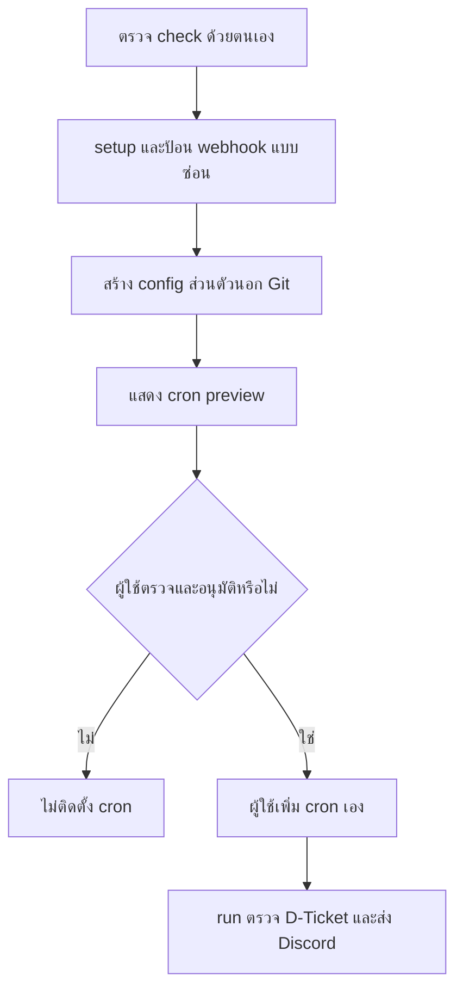

# D-Ticket monitor

[EN](README.md) | **TH**

เครื่องมือ Node.js สำหรับค้นหาสถานีและตรวจจำนวนที่เว็บไซต์ D-Ticket รายงานในหมวดรถนอนผู้โดยสารทั่วไป โปรแกรมอ่านข้อมูลเท่านั้น ไม่เข้าสู่ระบบ ไม่จอง ไม่เลือกที่นั่ง และไม่ชำระเงิน

จำนวนระดับหมวดไม่ใช่การยืนยันว่าเตียงบนหรือเตียงล่างว่าง ราคาก็ไม่ยืนยันว่าจองได้ ตรวจสอบกับ [D-Ticket](https://dticket.railway.co.th/DTicketPublicWeb/) ก่อนตัดสินใจ

## สิ่งที่ต้องมี

- Node.js 20 ขึ้นไป และไฟล์โปรเจกต์ในเครื่อง; npm ใช้สำหรับรันชุดทดสอบและติดตั้งแบบเฉพาะโฟลเดอร์ (ทางเลือก)
- อินเทอร์เน็ตสำหรับค้นหาข้อมูลจริง ไม่ต้องใช้ AI agent
- การตั้งเวลาในตัวอย่างต้องใช้ระบบ POSIX ที่มี cron และเทอร์มินัลแบบ TTY สำหรับป้อน webhook

แพ็กเกจตั้งค่า `private: true` และยังไม่ได้เผยแพร่บน npm อย่าใช้ `npx` โดยคาดว่าจะดาวน์โหลดแพ็กเกจนี้ได้

## เริ่มใช้งานจากโฟลเดอร์โปรเจกต์

หลังตรวจโค้ดและมีสำเนาโปรเจกต์ในเครื่องแล้ว:

```sh
cd /path/to/dticket-monitor
node --version
node dticket-cli.cjs --help
node dticket-cli.cjs station 'เชียงใหม่' --json
```

แทน `/path/to/dticket-monitor` ด้วย path จริง ตัวค้นหาสถานีจับคู่ชื่อไทยหรืออังกฤษบางส่วนโดยไม่แยกตัวพิมพ์ใหญ่เล็ก ผลจะแสดง `station_id` และ `station_no` ซึ่งเป็นคนละค่า หากไม่มีชื่อที่ตรง โปรแกรมไม่แสดงผลและออกด้วยสถานะ 0 ส่วนการเชื่อมต่อล้มเหลวออกด้วยสถานะ 1

ตรวจชื่อหรือ station ID ก่อนใช้ในเส้นทาง ชื่อใน `check` ต้องตรงทั้งชื่อโดยไม่แยกตัวพิมพ์ใหญ่เล็ก หากชื่อซ้ำให้เลือก `station_id` ไม่ใช่ `station_no`:

```sh
node dticket-cli.cjs check --origin ORIGIN_ID --destination DESTINATION_ID --date YYYY-MM-DD --train TRAIN_NUMBER --json
```

แทนค่าตัวพิมพ์ใหญ่ด้วยข้อมูลจริง วันที่ใช้ปี ค.ศ. เช่น `2027-01-01` ระบุ `--date` และ `--train` ซ้ำได้ หากไม่ระบุขบวน โปรแกรมจะตรวจทุกขบวนที่พบและอาจส่งคำขอจำนวนมาก `--json` ให้ผลแบบ JSON Lines ส่วน `--timeout 25` กำหนด timeout ต่อ HTTP request ไม่ใช่เวลารวม

ตัวอย่างรูปแบบผลจากเซิร์ฟเวอร์จำลองในการทดสอบ ไม่ใช่ข้อมูลรถไฟจริง:

```json
{"date":"2026-12-25","train":"42","origin_id":"174","destination_id":"174","departure":"2026-12-25 20:00","arrival":"2026-12-26 06:00","sleepers":[{"description":"ผู้โดยสารทั่วไป sleeper","class":"2","category_available_count":2,"fares_thb":{"Lower Berth":800,"Upper Berth":700}}]}
```

อ่าน `category_available_count` เป็นจำนวนระดับหมวดเท่านั้น หากผลมี `availability unknown` ข้อมูลบางส่วนผิดรูปหรือคำขอล้มเหลว อย่าตีความว่าตั๋วเต็ม เมื่อรายการเที่ยวว่างและไม่ได้เลือกขบวน โปรแกรมรายงานว่าไม่พบขบวน สถานะออก `0` หมายถึงตรวจครบโดยไม่มีข้อผิดพลาด, `1` หมายถึงมีข้อผิดพลาด และ `2` หมายถึง argument ไม่ถูกต้อง ตรวจทุกบรรทัดเมื่อมีทั้งผลและ error

## ใช้คำสั่ง dticket แบบเฉพาะโฟลเดอร์ (ทางเลือก)

การเรียก `node dticket-cli.cjs` ข้างต้นไม่ต้องติดตั้ง หากต้องการชื่อคำสั่ง `dticket` ใช้ npm ติดตั้งจากสำเนาในเครื่องไปยังโฟลเดอร์ใหม่ โดยไม่ติดตั้งระดับระบบ ตัวอย่าง POSIX:

```sh
mkdir -p "$HOME/dticket-local"
npm install --prefix "$HOME/dticket-local" --offline --ignore-scripts --no-audit --no-fund /path/to/dticket-monitor
"$HOME/dticket-local/node_modules/.bin/dticket" --help
```

แทน path โปรเจกต์ด้วย absolute path จริง คำสั่งนี้เขียนไฟล์ใน `dticket-local` ตรวจโฟลเดอร์ก่อนใช้ และอย่าใช้ `sudo` ทดสอบการติดตั้งและ `--help` แบบนี้ในโฟลเดอร์ scratch แยกแล้ว ไม่จำเป็นต้องใช้ `npm link` หรือเพิ่ม PATH ระบบ หากย้ายหรือลบแหล่งติดตั้ง ให้ติดตั้งใหม่และตรวจคำสั่งอีกครั้ง

## ตั้งเวลาและส่ง Discord (ทางเลือก)

ทดลอง `check` ก่อน `setup` จะสร้าง config และแสดง cron preview เท่านั้น ไม่ติดตั้ง cron และไม่ส่ง Discord ในขั้นตอน setup:



ตัวอย่าง POSIX จากโฟลเดอร์โปรเจกต์ สร้างไดเรกทอรีใหม่ที่อยู่นอก Git working tree ทั้งหมด หากมีอยู่แล้วให้ตรวจเจ้าของและสิทธิ์ก่อน ไม่ต้องสร้างซ้ำ:

```sh
mkdir -m 700 "$HOME/dticket-private"
node dticket-cli.cjs setup
```

ใน TTY โปรแกรมถามต้นทาง ปลายทาง วันที่แบบ `YYYY-MM-DD` (หลายวันคั่นด้วย comma) หมายเลขขบวนที่เลือกได้ ตาราง cron ห้าช่อง เช่น `0 */6 * * *` และ absolute path ของ config เช่น `/home/USER/dticket-private/config.json` แทน `USER` ด้วยชื่อจริง จากนั้นป้อน Discord webhook เองใน prompt ที่ซ่อนข้อความ ห้ามใส่ webhook ในคำสั่ง shell ประวัติ แชต หรือ Git

ไดเรกทอรีต้องมีอยู่แล้ว เป็นของผู้ใช้ที่รัน และไม่มีสิทธิ์ group/other โปรแกรมสร้าง config ใหม่แบบ `0600` และไม่เขียนทับไฟล์เดิม config เก็บทั้ง webhook และข้อมูลเส้นทาง ต้องเก็บเป็นความลับ Setup ต้องใช้ TTY; หากป้อนแบบซ่อนไม่ได้จะหยุด

ตรวจ cron preview ให้แน่ใจว่า path ของ Node, CLI และ config ยังใช้ได้ ตรวจ timezone และความถี่ของ cron ด้วย หากอนุมัติให้ผู้ใช้เพิ่มบรรทัดที่ตรวจแล้วเองโดยรักษา cron เดิมไว้ `node dticket-cli.cjs run --config "$HOME/dticket-private/config.json"` จะตรวจและส่ง Discord ทันที จึงต้องอนุมัติก่อนส่งจริง อย่าแชร์ config หรือ log ที่มีข้อมูลส่วนตัว

วันที่ใน config เป็นค่าตายตัว ส่งผลทุกรอบแม้ไม่เปลี่ยน ข้อความยาวถูกตัด ไม่มี retry หรือป้องกันงานซ้อน การตรวจมี timeout รวม 180 วินาทีและการส่งมี timeout แยก ผลอาจไม่ครบหรือส่งไม่สำเร็จ ตรวจสถานะและ log เอง ชุดทดสอบจำลองการส่งและการทำงานที่เกี่ยวกับ cron; **ยังไม่ได้ทดสอบ Discord หรือ cron จริงแบบครบวงจร** อย่าตั้งความถี่สูงโดยไม่จำเป็น และตรวจเงื่อนไขบริการต้นทาง

## ทดสอบในเครื่อง

```sh
npm test
```

ชุด Node ใช้เซิร์ฟเวอร์ HTTP ในเครื่องและ webhook จำลอง ไม่ยืนยันว่าเว็บไซต์จริงหรือ Discord จะทำงาน การตรวจเว็บจริงแยกจากชุดทดสอบ และผลอาจเปลี่ยนได้

## ใช้กับ AI agent

Agent ที่เรียกเทอร์มินัลได้อาจใช้ CLI โดยรับ path ของโปรเจกต์และอ่าน `SKILL.md` ก่อน แต่ยังไม่ได้ยืนยันความเข้ากันได้กับ agent แต่ละตัว ตัวอย่างคำสั่งให้ agent:

> ตรวจ README.th.md, SKILL.md และโค้ดใน `/path/to/dticket-monitor` ก่อน อธิบายขั้นตอนและขออนุมัติก่อนติดตั้งหรือคัดลอก Skill อย่าตั้ง cron หรือส่งข้อความโดยไม่ได้รับอนุมัติแยก อย่าขอ webhook ผ่านแชต ให้ฉันป้อนเองในเทอร์มินัลที่ซ่อนข้อความ

Skill เป็นเพียงคำแนะนำ ไม่รวมตัวโปรแกรม ดูวิธีติดตั้ง Skill ของ agent ที่ใช้ก่อนคัดลอก

## ความปลอดภัยและข้อจำกัด

- โปรแกรมส่งสถานีและวันเดินทางไปยัง D-Ticket และเมื่อใช้ `run` จะส่งผลไป Discord ข้อมูลเส้นทางที่อยู่ใน arguments อาจปรากฏในรายการ process ตามสิทธิ์ระบบ; ผลอาจอยู่ใน log หรือประวัติ shell
- โปรแกรมใช้ endpoint ภายในของเว็บไซต์ซึ่งไม่มีเอกสาร API อย่างเป็นทางการ และอาจเปลี่ยนหรือหยุดทำงาน ตรวจโค้ดและใช้สิทธิ์เท่าที่จำเป็น
- SkillSpector 2.12.0 สแกนฉบับพัฒนา Node แบบ static โดยไม่ใช้ LLM ได้ 44/100 (MEDIUM / CAUTION) และพบข้อเตือน HIGH หนึ่งรายการที่ตัวอย่าง cron ใน README; ผลนี้ไม่รับประกันความปลอดภัย และไม่ได้ตรวจการส่ง Discord หรือ cron จริงแบบครบวงจร
- หากค้นหาสถานีไม่พบ ลองชื่อบางส่วนหรือภาษาอังกฤษ หากพบ `availability unknown` ตรวจเครือข่ายหรือลองเว็บไซต์โดยตรง อย่าสรุปว่าตั๋วเต็ม

## ใบอนุญาต

[MIT License](LICENSE)
